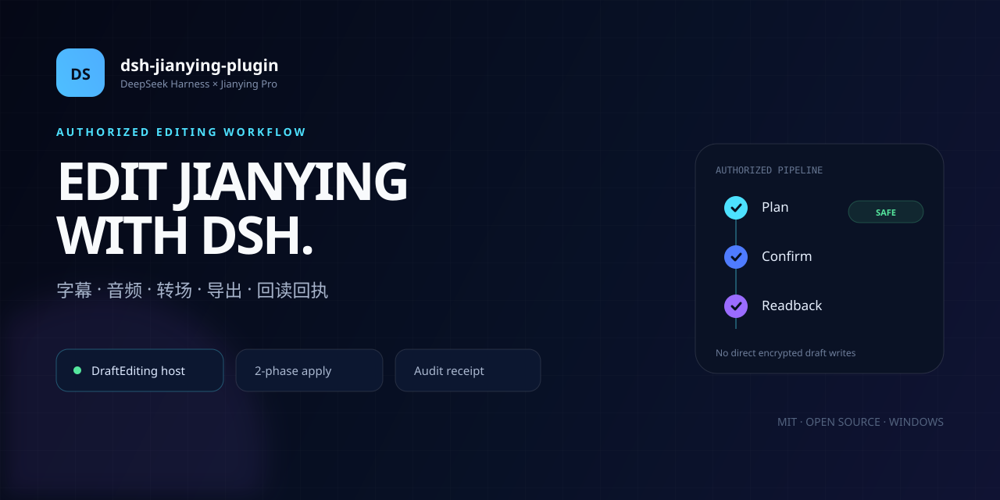
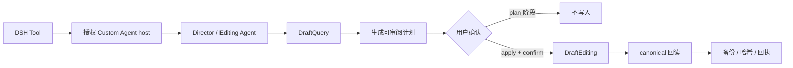

<div align="center">


# dsh-jianying-plugin

### 让 DeepSeek Harness 真正剪得动剪映草稿

字幕 · 音频 · 转场 · 导出 · 回读 · 编辑回执

[](https://github.com/CN-PA/dsh-jianying-plugin/actions/workflows/ci.yml)
[](https://cn-pa.github.io/dsh-jianying-plugin/)
[](https://github.com/CN-PA/dsh-jianying-plugin/releases/latest)
[](LICENSE)
[](#兼容性)

[项目主页](https://cn-pa.github.io/dsh-jianying-plugin/) ·
[快速安装](#-快速开始) ·
[工具矩阵](#-工具矩阵) ·
[安全机制](#-安全机制) ·
[English](README.en.md) ·
[最新版本](https://github.com/CN-PA/dsh-jianying-plugin/releases/latest)



</div>

> **这是一个能让 DSH 操作真实剪映草稿的开源插件。**
>
> 它不直接修改加密的 `draft_content.json`，而是连接剪映正在运行的授权 Custom Agent host，通过官方 DraftEditing 链路完成编辑，并在写入后回读草稿、生成可审计回执。

## ✨ 为什么值得试试

<table>
<tr>
<td width="50%">

### 🎬 真的编辑草稿

不是生成一段剪辑建议，也不是做一个看起来像剪映的预览。插件直接操作用户正在使用的剪映草稿。

</td>
<td width="50%">

### 🛡️ 两阶段写入

先读取，再规划；只有用户明确确认后才执行。计划成功不等于草稿已修改。

</td>
</tr>
<tr>
<td>

### 🔎 可回读、可追溯

写入前后采集草稿哈希，读取 canonical 状态，并生成 JSON / Markdown 编辑回执。

</td>
<td>

### 🩺 一键诊断

`jianying_doctor` 会检查安装、CLI、草稿表、剪映进程、授权 host 和 Agent 会话，并告诉你下一步怎么修。

</td>
</tr>
</table>

## 🚀 快速开始

### 环境要求

| 项目 | 要求 |
|---|---|
| 系统 | Windows 10 / 11 x64 |
| DSH | DSH Desktop |
| 剪映 | 剪映专业版，已安装并至少启动或登录过一次 |
| 剪映能力 | Custom Agent host 可用 |
| 开发环境 | Node.js 22+ |

### 一键安装

打开 PowerShell：

```powershell
irm https://raw.githubusercontent.com/CN-PA/dsh-jianying-plugin/main/scripts/install.ps1 | iex
```

安装脚本会：

1. 获取 GitHub 最新 Release；
2. 校验附件 SHA-256；
3. 下载插件；
4. 安装到 DSH `desktop` profile。

<details>
<summary><b>自定义 profile 或 DSH 安装路径</b></summary>

```powershell
.\scripts\install.ps1 `
  -Profile github-test `
  -DshCommand 'F:\dsh\resources\runtime\cli\bin\dsh.cmd'
```

</details>

<details>
<summary><b>手动安装</b></summary>

从 [Releases](https://github.com/CN-PA/dsh-jianying-plugin/releases/latest) 下载 `.tgz`：

```powershell
dsh plugin --profile desktop add file:F:/Downloads/dsh-jianying-plugin-0.3.0.tgz
```

或者直接从仓库安装：

```powershell
dsh plugin --profile desktop add github:CN-PA/dsh-jianying-plugin
```

</details>

### 第一次使用

1. 启动剪映专业版。
2. 打开一次剪映 Agent 面板，让授权 host 和会话存在。
3. 在 DSH 中调用：

```text
jianying_doctor
```

4. 所有检查通过后，对 DSH 说：

```text
列出我的剪映草稿，检查最新草稿，并只读回读。
```

## 🧭 工作流



## 🛡️ 安全机制

> **不碰加密草稿内部格式，不跳过剪映授权边界。**

- `mode=plan` 只创建计划，不写入草稿。
- `mode=apply` 必须显式传入 `confirm=true`。
- 运行期额外权限默认不自动批准。
- apply 前默认备份草稿 JSON。
- 写入后对比文件哈希并回读 canonical 状态。
- 导出默认拒绝覆盖已有文件。
- host token 不返回给模型、不写入日志、不保存到回执。
- 部分完成或失败不会被报告成“成功”。

```text
读取草稿
  → 规划最小范围修改
  → 用户确认
  → 授权 DraftEditing 应用
  → 回读核对
  → JSON + Markdown 回执
```

## 🧰 工具矩阵

| 工具 | 能做什么 |
|---|---|
| `jianying_doctor` | 一次检查完整环境，返回逐项状态与修复建议。 |
| `jianying_status` | 查看剪映版本、CLI、草稿注册表、进程和能力。 |
| `jianying_drafts` | 列出、检查或启动剪映草稿。 |
| `jianying_host` | 查看 host、会话、草稿回读、run 状态，取消任务。 |
| `jianying_edit` | 通用高级编辑：计划或应用。 |
| `jianying_subtitle` | 添加、更新、删除字幕。 |
| `jianying_audio` | 音量、裁切、淡入淡出。 |
| `jianying_transition` | 添加、更新、删除转场。 |
| `jianying_export` | 导出草稿，默认不覆盖已有文件。 |
| `jianying_receipt` | 列出或读取编辑回执。 |
| `jianying_cli` | 官方 Agent CLI 的查询、规划、校验和受保护 apply。 |

## 🎬 支持的高级操作

时间单位统一为**毫秒**。音频音量使用剪映范围 `0..1000`，`100` 表示原始幅度。

| 类型 | 操作 |
|---|---|
| 字幕 | `subtitle.add`、`subtitle.update`、`subtitle.remove` |
| 音频 | `audio.set_volume`、`audio.trim`、`audio.fade` |
| 转场 | `transition.add`、`transition.update`、`transition.remove` |
| 导出 | `export` |

<details>
<summary><b>查看一次组合编辑示例</b></summary>

```json
[
  {
    "kind": "subtitle.add",
    "text": "欢迎观看",
    "start_ms": 0,
    "duration_ms": 2000
  },
  {
    "kind": "audio.set_volume",
    "segment_id": "audio-segment-id",
    "volume": 65
  },
  {
    "kind": "transition.add",
    "segment_id": "video-segment-id",
    "transition_name": "叠化",
    "duration_ms": 500
  }
]
```

</details>

<details>
<summary><b>先规划，不写入</b></summary>

```json
{
  "draft_id": "DRAFT-ID",
  "mode": "plan",
  "operations": [
    {
      "kind": "subtitle.add",
      "text": "测试字幕",
      "start_ms": 0,
      "duration_ms": 1500
    }
  ]
}
```

</details>

<details>
<summary><b>用户确认后应用并回读</b></summary>

```json
{
  "draft_id": "DRAFT-ID",
  "mode": "apply",
  "confirm": true,
  "operations": [
    {
      "kind": "subtitle.add",
      "text": "测试字幕",
      "start_ms": 0,
      "duration_ms": 1500
    }
  ]
}
```

</details>

更完整的字幕、音频、转场、导出和回执示例见 [中文详细文档](README.zh-CN.md)。

## 📋 编辑回执

默认保存在：

```text
F:/Codex/.dsh-jianying-plugin/
├── backups/       # 写入前草稿 JSON 备份
└── receipts/      # JSON + Markdown 编辑证据
```

每次 apply 会记录：

- 草稿 ID、名称和路径；
- 修改前后 revision hash；
- 备份位置；
- 请求的操作；
- host task / run / plan ID；
- canonical 回读结果；
- 警告、失败和时间；
- 实际操作的片段 ID 与时间范围。

## ⚙️ 配置

```yaml
installDirs:
  - E:/JianyingPro
  - F:/JianyingPro
tempRoot: F:/Codex/.dsh-jianying-plugin
allowApply: false
allowHostApply: true
createBackup: true
hostPollIntervalMs: 2000
hostWorkflowTimeoutMs: 300000
```

- `allowApply`：只控制旧版 `jianying_cli apply-patch`。
- `allowHostApply`：控制新版高级编辑和导出。
- `createBackup`：是否在 apply 前备份草稿 JSON。
- `hostWorkflowTimeoutMs`：默认等待时间。

也可以手动指定 `instanceId` 和 `sessionId`，通常不需要。

## 💻 兼容性

已验证：

| 环境 | 版本 |
|---|---|
| 系统 | Windows 11 x64 |
| DSH Desktop | `26.1111.2228.0` |
| 剪映专业版 | `11.7.0.14652` |
| 剪映专业版 | `11.8.0.14778` |
| Node CI | 22 / 24 |
| CI 平台 | Windows / Linux |

剪映 Custom Agent host 是否可用会受到版本、账号和灰度发布影响。提交兼容性问题前，请先运行 `jianying_doctor`。

> [!NOTE]
> 独立运行 `lyra-cli.exe` 会被剪映以 `unauthorized host process` 拒绝。这是上游安全限制，插件不会绕过它。

## 🧪 开发与测试

```powershell
npm.cmd test
npm.cmd run check
npm.cmd run validate:manifest
npm.cmd run smoke
npm.cmd run smoke:host
npm.cmd run pack:release
```

当前覆盖：

- **22 项自动化测试**；
- 模拟授权 host 的端到端 plan → confirm → apply → readback → receipt；
- 真实剪映只读集成测试；
- Windows / Linux、Node 22 / 24 公共 CI。

更多文档：

- [完整中文使用文档](README.zh-CN.md)
- [功能测试矩阵](docs/FEATURE_MATRIX.md)
- [测试指南](docs/TESTING.md)
- [发布指南](docs/PUBLISHING.md)
- [推广素材](docs/PROMOTION.zh-CN.md)
- [安全策略](SECURITY.md)

## ❤️ 参与项目

如果这个插件节省了你的时间：

- ⭐ 给仓库一个 Star；
- 🐛 提交剪映版本兼容、安装或编辑问题；
- 💡 分享真实剪辑场景；
- 🔧 提交字幕、音频、转场和导出相关改进。

[反馈问题](https://github.com/CN-PA/dsh-jianying-plugin/issues/new/choose) ·
[参与讨论](https://github.com/CN-PA/dsh-jianying-plugin/discussions) ·
[查看项目主页](https://cn-pa.github.io/dsh-jianying-plugin/)

<div align="center">

**Built with care for DSH × 剪映专业版**

MIT License · Windows only

</div>
